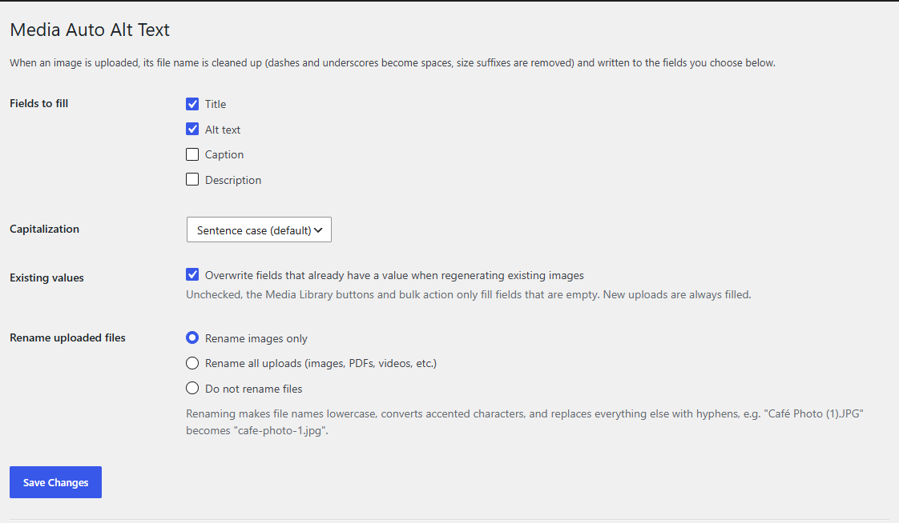
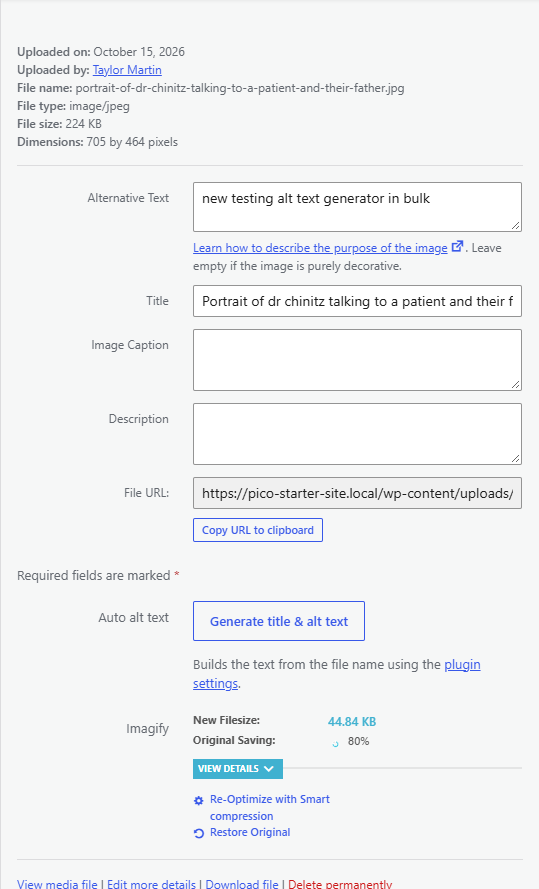
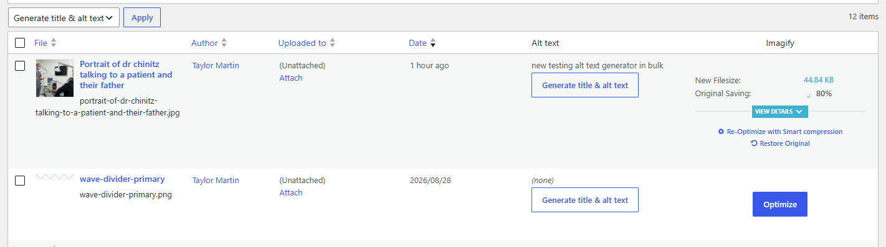
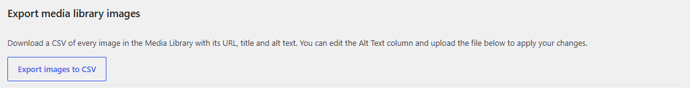
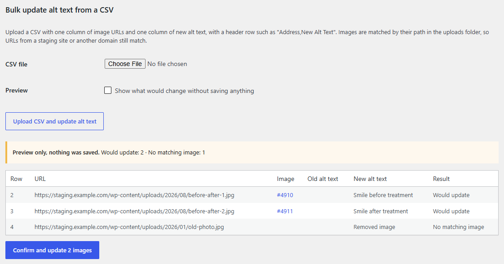

# Media Auto Alt Text Creation

A WordPress plugin that gives every image in the Media Library a readable title and alt text, and lets you review and bulk-edit alt text across a whole site with a spreadsheet.

**What it handles:**

- **New uploads:** each image gets a title and alt text built from its file name as soon as it is uploaded.
- **Existing images:** you can regenerate the title and alt text one image at a time or many at once.
- **Bulk editing:** you can export every image to a CSV, write better alt text in a spreadsheet, and upload it back. URLs from a staging site still match the live site.

---

## Contents

- [Installing](#installing)
- [How the text is generated](#how-the-text-is-generated)
- [Settings](#settings)
- [Regenerating existing images](#regenerating-existing-images)
- [Exporting images to CSV](#exporting-images-to-csv)
- [Bulk updating alt text from a CSV](#bulk-updating-alt-text-from-a-csv)
- [Typical workflow for a site audit](#typical-workflow-for-a-site-audit)
- [FAQ](#faq)
- [For developers](#for-developers)

---

## Installing

1. On GitHub, click **Code > Download ZIP**.
2. Unzip it and rename the folder from `Media-Auto-Alt-Text-Creation-main` to `media-auto-alt-text-creation`.
3. Zip the renamed folder. Then, in WordPress, go to **Plugins > Add New > Upload Plugin**, upload the zip, and click **Activate**.
4. If the site uses **Auto Image Title & Alt** (or another plugin that sets alt text on upload), deactivate it. Otherwise both plugins edit every upload.

Settings are under **Settings > Media Alt Text**. There's also a **Settings** link on the plugin's row on the Plugins screen.

Requires WordPress 5.8+ and PHP 7.4+.

---

## How the text is generated

The plugin builds the text from the image's file name:

1. It removes the file extension.
2. It removes suffixes added by WordPress or image editors: `-scaled`, `-rotated`, dimension suffixes like `-1024x768`, and editor timestamps like `-e1712345678`.
3. It turns dashes, underscores, dots and plus signs into single spaces.
4. It applies the capitalization style you choose in the settings.

| File name | Generated text (Sentence case) |
|---|---|
| `my_photo-of-the-BEACH-1024x768-scaled.jpg` | My photo of the beach |
| `team-photo-e1712345678901.jpg` | Team photo |
| `Café Niño.png` | Café niño |
| `IMG_1234.JPG` | Img 1234 |

> **Tip:** the generated text is only as good as the file name. `dr-smith-explaining-x-ray-to-patient.jpg` gives useful alt text, but `IMG_1234.jpg` does not. Ask whoever uploads images to name files descriptively. For images whose names can't be fixed, write the alt text by hand or use the [CSV workflow](#bulk-updating-alt-text-from-a-csv).

---

## Settings

**Settings > Media Alt Text**



### Fields to fill

Choose which fields get the generated text. **Title** and **Alt text** are on by default.

| Field | Where it's used |
|---|---|
| **Title** | The image's name in the Media Library and admin screens. |
| **Alt text** | The `alt` attribute on the `` tag. Screen readers read it aloud, and search engines use it to understand the image. This is the field that matters most for accessibility and SEO. |
| **Caption** | Text shown under the image on the page, when the theme or block displays captions. Usually best left off, so file-name text doesn't show up on the site. |
| **Description** | Shown on the image's attachment page. Rarely needed. |

If no fields are ticked, the plugin doesn't write anything, but uploads can still be renamed (see below).

### Capitalization

How the generated text is capitalized:

| Option | Example |
|---|---|
| **Sentence case (default)** | My photo of the beach |
| Title Case | My Photo Of The Beach |
| lowercase | my photo of the beach |
| UPPERCASE | MY PHOTO OF THE BEACH |
| Leave as is | my photo of the BEACH (keeps the file name's own capitalization) |

Sentence case is the default because it reads most naturally for alt text.

### Existing values

**Overwrite fields that already have a value when regenerating existing images** (on by default)

This only affects the **Generate title & alt text** buttons and the bulk action, which regenerate text for images that are already in the library:

- **Checked:** the selected fields are replaced with freshly generated text, even if someone already wrote something.
- **Unchecked:** only empty fields are filled. Alt text someone wrote by hand is kept.

Uncheck this before running the bulk action on an established site, so hand-written alt text isn't replaced.

New uploads always get the generated text, whatever this setting says.

### Rename uploaded files

Tidies file names as they are uploaded, before WordPress saves them. The file name becomes lowercase, accented letters become plain letters, and every other character becomes a hyphen.

`Café Photo (1).JPG` becomes `cafe-photo-1.jpg`

| Option | What it does |
|---|---|
| **Rename images only (default)** | Only images are renamed. |
| Rename all uploads | Images, PDFs, videos and every other file type are renamed. |
| Do not rename files | File names are left exactly as uploaded. |

Renaming only affects new uploads. Files already in the library keep their names, so existing links don't break.

---

## Regenerating existing images

Images uploaded before the plugin was activated (or before you changed the settings) can be regenerated in three places. All of them use the current settings, including **Existing values**.

### In the media popup or on the image edit screen

Open any image in the Media Library (or in the media popup while editing a page) and click **Generate title & alt text** under **Auto alt text**. The fields update straight away, so there's no need to reload the page.



The same button also appears on the full **Edit Media** screen.

### In the Media Library list view

Switch the Media Library to **list view** (the list icon at the top left). The plugin adds an **Alt text** column that shows each image's current alt text, or *(none)* if it's empty, with a **Generate title & alt text** button for that image.

To update many images at once, tick them, choose **Generate title & alt text** from the **Bulk actions** menu, and click **Apply**. A notice says how many images were updated.



The *(none)* entries in the Alt text column make it easy to find images that still need alt text.

---

## Exporting images to CSV

At the bottom of the settings page, **Export images to CSV** downloads a spreadsheet of every image in the Media Library.



The file has four columns:

| ID | Address | Title | Alt Text |
|---|---|---|---|
| 5058 | https://example.com/wp-content/uploads/2026/10/portrait-of-dr-smith.jpg | Portrait of dr smith | Dr Smith talking with a patient |

The file opens directly in Excel or Google Sheets, accented characters included. It's already in the format the CSV import below expects, so you can edit the **Alt Text** column and upload the same file to apply your changes.

---

## Bulk updating alt text from a CSV

Use this to apply alt text written in a spreadsheet, for example by a copywriter or an SEO audit, to many images at once.



### Preparing the CSV

The file needs a column of image URLs and a column of alt text, with a header row. Either of these works:

```csv
Address,New Alt Text
https://staging.example.com/wp-content/uploads/2026/10/portrait-of-dr-smith.jpg,Dr Smith talking with a patient and their father
https://staging.example.com/wp-content/uploads/2026/05/mother-and-child.jpg,A mother holding her child at the dentist
```

```csv
ID,Address,Title,Alt Text
5058,https://example.com/wp-content/uploads/2026/10/portrait-of-dr-smith.jpg,Portrait of dr smith,Dr Smith talking with a patient
```

- **URL column:** the plugin uses the first column whose header contains *url*, *address*, *image*, *src*, *link* or *file*.
- **Alt text column:** the plugin uses the first column whose header contains *alt*.
- **No recognizable header:** the first column is treated as the URL and the second as the alt text.
- **Other columns** (like ID and Title from the export) are ignored, so the export file can be uploaded as is.

### How images are matched

Images are matched by their path inside the uploads folder. **The domain is ignored**, so a CSV made on a staging site works on the live site:

- `https://staging.example.com/wp-content/uploads/2026/10/photo.jpg`
- `https://www.example.com/wp-content/uploads/2026/10/photo.jpg`
- `/wp-content/uploads/2026/10/photo.jpg`

All three of these match the same image, `2026/10/photo.jpg`.

It also matches:

- **Resized copies:** a URL for `photo-300x200.jpg` updates the alt text of `photo.jpg`.
- **Scaled originals:** a URL for `photo.jpg` matches an image WordPress stored as `photo-scaled.jpg`.
- **Sites in a subfolder** or with a custom uploads folder.

Only the **alt text** is changed. Titles, captions and descriptions are left alone.

### Preview, then confirm

1. Choose the CSV file.
2. Tick **Preview** to see what would change without saving anything. (Leave it unticked to apply the changes straight away.)
3. Click **Upload CSV and update alt text**.
4. Check the results table. It shows every row with the matched image (click the #ID to open it), the old alt text, the new alt text and the result.
5. If everything looks right, click **Confirm and update N images**. There's no need to upload the file again. The images are matched again at this point, so the update reflects the library as it is now.

The preview stays available for one hour. After that, upload the CSV again.

### What the results mean

| Result | Meaning |
|---|---|
| **Would update** / **Updated** | The image was found and its alt text will be / was changed. |
| **Already set** | The image already has exactly this alt text. Nothing to do. |
| **No matching image** | No image in this site's Media Library has that path. The image may have been deleted, uploaded under a different name, or exist only on another site. |
| **Skipped (missing URL or alt text)** | The row's URL or alt text cell is blank. Blank alt text never clears an existing value. |

---

## Typical workflow for a site audit

1. **Export:** on the live site, go to **Settings > Media Alt Text** and click **Export images to CSV**.
2. **Write:** open the file in Google Sheets or Excel and write proper alt text in the **Alt Text** column. Use the **Address** column to view each image. Leave a cell blank to keep that image's current alt text.
3. **Save as CSV:** in Google Sheets, use *File > Download > Comma-separated values*. In Excel, use *Save As > CSV UTF-8*.
4. **Preview:** upload the file with **Preview** ticked and review the table. Look for any **No matching image** rows.
5. **Confirm:** click **Confirm and update N images**.
6. **Spot check:** open a few pages on the site and inspect the images, or check the **Alt text** column in Media Library list view.

You can do steps 1–4 on staging and the final upload on live. The domain doesn't matter.

---

## FAQ

**Does it change images that are already uploaded when I activate it?**
No. Only new uploads are filled automatically. Existing images change only when someone clicks a Generate button, runs the bulk action, or uploads a CSV.

**Will it overwrite alt text someone wrote by hand?**
It can, so be careful:

- **New uploads:** the generated text is always written.
- **Generate buttons and the bulk action:** these overwrite existing text only when **Existing values** is checked. Uncheck it to only fill empty fields.
- **CSV import:** this replaces the alt text of every row you include. Rows with blank alt text are skipped.

**Does it work with SVGs?**
Yes. If the site allows SVG uploads, SVGs are treated like any other image.

**Who can use it?**
Only administrators can change settings, export, or import CSVs. Anyone who can edit an image can use its Generate button.

**What happens when I uninstall it?**
Deleting the plugin removes its settings. Titles and alt text it already wrote stay on the images.

---

## For developers

- **Prefix:** all functions, options and hooks use `maatc_`. Settings are stored in the `maatc_settings` option.
- **Filter the generated text** before it's saved:

  ```php
  add_filter( 'maatc_generated_text', function ( $text, $filename ) {
  	return str_replace( 'Img ', '', $text );
  }, 10, 2 );
  ```

- **Code layout:**
  - `includes/generator.php`: text generation, the upload hook and file renaming.
  - `includes/settings.php`: the settings page.
  - `includes/admin.php`: the Generate buttons, Media Library column, bulk action and AJAX handler.
  - `includes/csv-import.php`: CSV export, import, preview and confirm.
  - `assets/admin.js`: the Generate button behaviour.
